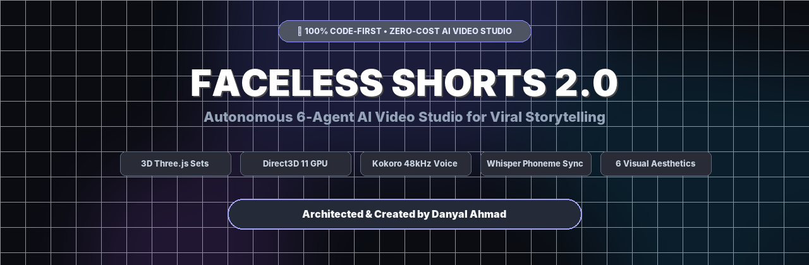
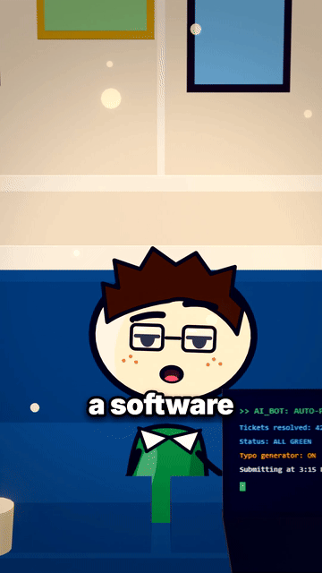
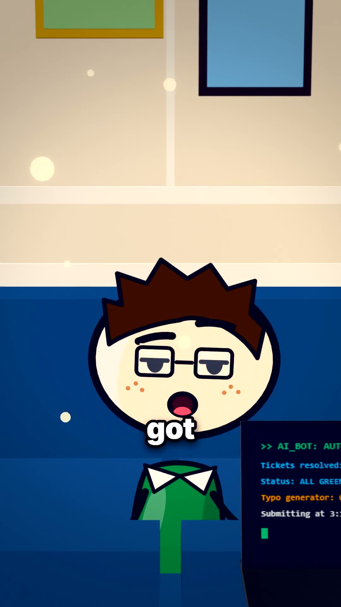
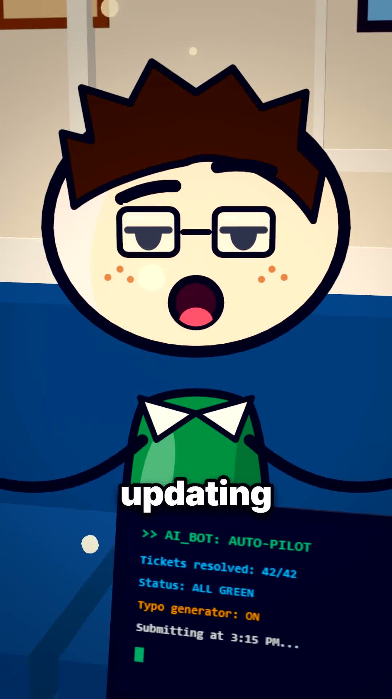
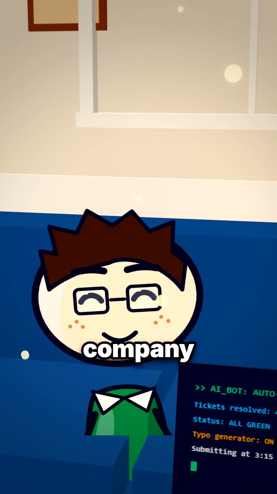
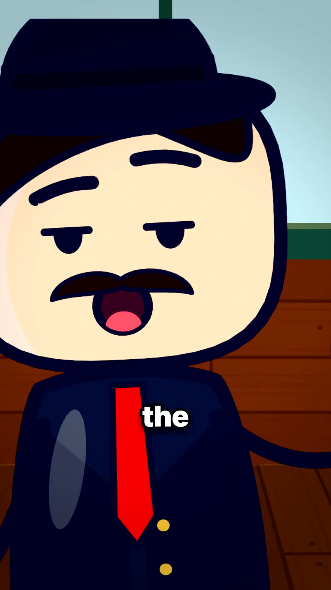
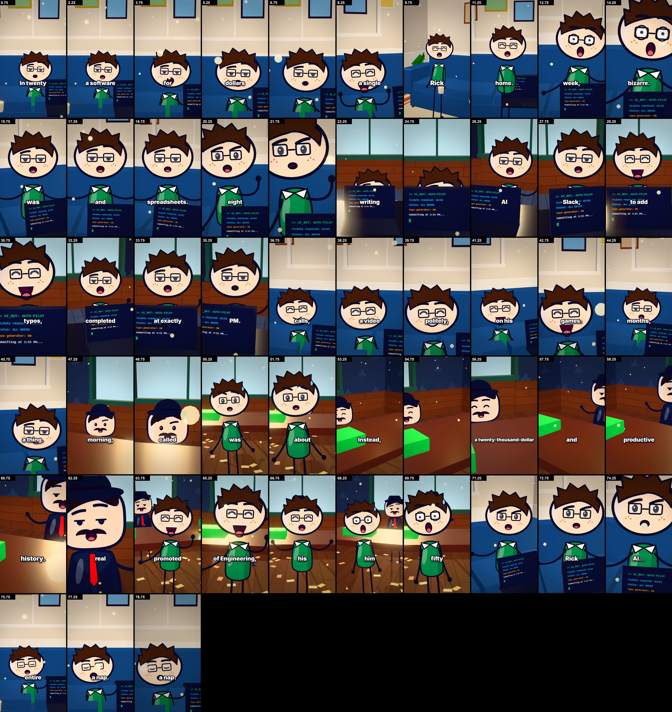
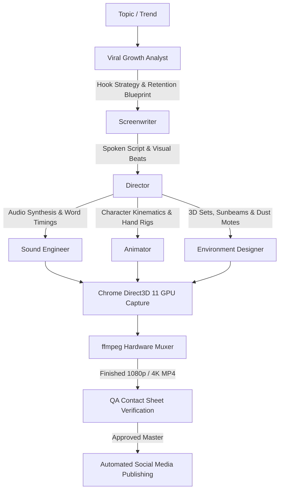

<div align="center">



# 🎬 Faceless Shorts 2.0
### **The Autonomous 6-Agent AI Video Studio for Viral Storytelling**
*100% Code-First • Zero API Cost • Direct3D 11 GPU Accelerated • Mathematical 2D/3D Kinetics*

<br>

[](https://linkedin.com/in/danyal-ahmaad)
[](LICENSE)
[](#-direct3d-11-gpu-hardware-acceleration)
[](#-zero-cost-local-audio--whisper-alignment)
[](#-zero-cost-local-audio--whisper-alignment)
[](#-why-code-driven-graphics-outperform-diffusion-models)

---

### ⚡ Watch the Engine in Motion



<p><i>Real-time procedural 2D characters rendered on living 3D Three.js sets with continuous camera dollies, physical sunlit dust motes, and sub-10ms Whisper lip-sync.</i></p>

</div>

---

## 📸 Production Frame Showcase

Faceless Shorts 2.0 generates complete 9:16 vertical storytelling videos directly from procedural code. Flat 2D cartoon characters with expressive facial acting live within depth-mapped 3D Three.js architectural environments featuring physical sunbeams, continuous camera dollies, dynamic charcoal comic ink, and active dust motes.

<table width="100%">
  <tr>
    <td width="50%" align="center">
      <br>
      <b>3D Workspace with Volumetric Sunbeams & Dust Motes</b>
    </td>
    <td width="50%" align="center">
      <br>
      <b>Character Rigging & Expressive Comic Face Acting</b>
    </td>
  </tr>
  <tr>
    <td width="50%" align="center">
      <br>
      <b>Vector Code Terminals & Pixel-Crisp Typography</b>
    </td>
    <td width="50%" align="center">
      <br>
      <b>Procedural Props, Eyewear & Secondary Physics</b>
    </td>
  </tr>
</table>

### 🔍 53-Frame Production QA Verification Matrix
Every sequence undergoes strict frame-by-frame verification across character anatomy, camera Bézier velocity, volume preservation, and viseme synchronization:

<p align="center">
  
</p>

---

## ⚡ Why Code-Driven Graphics Outperform Diffusion Models

Traditional generative AI video models (Runway Gen-3, OpenAI Sora, Pika, Kling, Luma) generate frames from diffusion latents. While photorealistic in still frames, they fail critically when applied to structured viral education and storytelling:

| Architectural Dimension | Generative Diffusion Video (Runway / Sora / Kling) | Faceless Shorts 2.0 Engine |
|---|---|---|
| **Text & Code Legibility** | Hallucinates unreadable glyphs; incapable of rendering real code, terminal text, or legible UI. | **100% Vector Precision**: Canvas and SVG typography with pixel-crisp fonts and vector sharpness. |
| **Temporal Consistency** | Severe morphing, hallucinated limbs, shifting facial features, floating objects between cuts. | **Strict Rigging**: Characters possess deterministic mathematical bones, joints, and stable comic inks. |
| **Physical Mass & Weight** | Characters float, dissolve, and teleport without physical grounding or true momentum. | **12 Disney Principles**: Volume-preserving squash & stretch ($s_x = 1/\sqrt{s_y}$) and RK4 spring dynamics. |
| **Audio-Visual Sync** | Narration is tacked on post-render; mouth movements are loosely hallucinated or unsynced. | **Sub-10ms Precision**: Local Whisper extracts phonetic timestamps, driving 8 distinct visemes. |
| **Camera Choreography** | Vague natural-language prompting with unpredictable camera drift and sudden speed jumps. | **Deterministic 3D Math**: Spline-based Three.js cameras with exact cubic Bézier acceleration curves. |
| **Environment Continuity** | Background props and room geometry mutate whenever the camera shifts angle. | **Persistent 3D Worlds**: True 3D geometry, instanced particles, and static lighting coordinates. |
| **Operating Cost** | Expensive recurring cloud fees ($0.20–$2.00 per minute of video). | **$0.00 / Zero API Keys**: 100% local neural voice, local Whisper, and local GPU rasterization. |

---

## 🤖 The 6 Autonomous Production Agents

Faceless Shorts 2.0 operates as an automated production studio where 6 specialized AI agents orchestrate the end-to-end pipeline:



<details>
<summary><b>🔍 Click to expand details on the 6 Autonomous Agents</b></summary>

<br>

### 1. 🎬 Executive Director (`agents/director.md`)
- **Mandate**: Showrunner, cinematic continuity, and pacing supervisor.
- **Key Responsibilities**:
  - Enforces the **30-Second Rule**: pattern interrupt, perspective switch, or punchline every 30 seconds.
  - Controls camera choreography (smooth Bézier dollies, dutch tilts, whip pans, and crash zooms).
  - Approves final 53-frame contact sheets before master release.

### 2. ✍️ Viral Screenwriter (`agents/screenwriter.md`)
- **Mandate**: Retention engineering and phonetically spoken narrative.
- **Key Responsibilities**:
  - Eliminates the 0–3 second dropoff with in-medias-res hook architecture.
  - Writes exclusively for the ear: spoken rhythm, natural cadence, and phonetic number expansion ("seventy thousand dollars", not "$70,000").
  - Engineers circular loop endings connecting the final word back into the opening hook.

### 3. 🎨 Master Animator (`agents/animator.md`)
- **Mandate**: 2D/3D procedural character kinematics and expressive rigging.
- **Key Responsibilities**:
  - Implements the 12 Disney Principles in mathematical code.
  - Enforces customizable deep comic inks (`#181C24` / `#0F172A`)—eliminating harsh default outlines.
  - Rigs 5 distinct body archetypes: `lean`, `heavy` (boss), `athletic`, `standard`, and `kid`.
  - Animates 14 facial acting emotions and functional hand states (`type`, `point`, `fist`, `coffeeMug`, `smartphone`).

### 4. 🏛️ Environment Designer (`agents/environment-designer.md`)
- **Mandate**: Living 3D spatial sets and volumetric lighting.
- **Key Responsibilities**:
  - Builds Three.js architectural sets (modern developer workspaces, executive boardrooms, forensic laboratories).
  - Simulates dynamic sunbeams with sinusoidal Brownian dust motes (`dustMotes`).
  - Implements contact shadow planes ($y = 0.005$) and post-processing depth of field (`BokehShader`).

### 5. 🎧 Sound & Foley Engineer (`agents/sound-engineer.md`)
- **Mandate**: Voice synthesis, phoneme alignment, and broadcast audio mastering.
- **Key Responsibilities**:
  - Drives local Kokoro neural TTS (82M parameter model, 48 kHz broadcast audio).
  - Aligns words with OpenAI Whisper for word-level and syllable-level timestamps (`words.json`).
  - Masters multi-track spatial Foley audio: whooshes, comic boings, typewriter clicks, pops, and sub-bass drops.

### 6. 📈 Viral Growth Analyst (`agents/viral-growth-analyst.md`)
- **Mandate**: Trend forecasting, distribution, and lead capture.
- **Key Responsibilities**:
  - Analyzes high-velocity GitHub and AI repositories for viral educational hooks.
  - Automated stealth social publishing with humanized keystrokes and anti-detection delays.
  - Delivers comment-to-DM automated lead flows.

</details>

---

## 🎨 6 Distinct Production Aesthetics

The engine provides 6 distinct, fully programmed visual styles:

| Style | Aesthetic Name | Visual Description | Best Used For |
|---|---|---|---|
| `tall-tale` | **Tall Tale 3D** | Flat 2D cartoon characters in sunny 3D Three.js worlds with moving cameras and dust motes (RicksClips style). | Funny true stories, tech loopholes, developer culture, and startup lore. |
| `deep-dive` | **Deep Dive 3D** | High-precision 3D human anatomy with glowing x-ray cutaways and macro camera paths (Zack D. Films style). | "What happens if...?" biology, human health, and material science. |
| `night-file` | **Night File 3D** | Dark volumetric rooms with high-contrast single-source lighting and glowing red forensic subjects. | Unsolved mysteries, cybercrime, true history, and deep-web investigations. |
| `inside-out` | **Inside Out 2D** | Flat, punchy 2D medical and anatomical explainers with bold 1–3 word kinetic typography. | Rapid science explainers and physiological mechanics. |
| `stick-story` | **Stick Story** | Expressive minimalist stick figures with acting eyes, gold decision cards, and situational survival maps. | Survival guides, life hacks, and decision-tree explainers. |
| `paper-atlas` | **Paper Atlas** | Textured parchment cut-paper cartography with crimson routes and gold historical date ribbons. | Historical conflicts, geopolitics, and ancient engineering feats. |

---

## 🔬 Mathematical Kinematics & Rigging

### 1. Volume-Preserving Squash and Stretch
To preserve character mass during impacts, jump landings, and shock reactions, the horizontal scale is computed as the exact reciprocal square root of vertical deformation:

$$\text{scale}_X = \frac{1}{\sqrt{\text{scale}_Y}} = \frac{1}{\sqrt{1 + \text{squash}}}$$

```javascript
// Volume-preserving squash & stretch implementation
const sy = 1 + (st.squash || 0);
const sx = 1 / Math.sqrt(Math.max(0.1, sy));
ctx.scale(sx, sy);
```

### 2. Secondary Inertia & RK4 Spring Dynamics
Neckties, hair strands, and accessories follow dynamic Runge-Kutta 4th Order (RK4) spring physics to eliminate robotic mechanical motion:

$$\ddot{x} + 2\zeta\omega_n\dot{x} + \omega_n^2 x = 0$$

```javascript
// Dynamic spring lag applied to secondary appendages
st.tieAngle = lerp(st.tieAngle, -st.vx * 0.12 + Math.sin(t * 8) * 0.05, 0.18);
```

### 3. Instanced Brownian Dust Particles
Three.js instanced meshes simulate ambient sunlight drift through trigonometric Brownian displacement:

```javascript
// Physical dust mote motion in Three.js
for (let i = 0; i < COUNT; i++) {
  dummy.position.set(
    p[i*3]   + Math.sin(t * 0.4 + i) * 0.15,
    p[i*3+1] + Math.cos(t * 0.3 + i * 2) * 0.10,
    p[i*3+2] + Math.sin(t * 0.2 + i * 0.5) * 0.12
  );
  dummy.updateMatrix();
  instancedMesh.setMatrixAt(i, dummy.matrix);
}
```

---

## 🚀 Quickstart & One-Command Studio Launch (LOCAL MACHINE)

### 1. Clone the Repository
```bash
git clone https://github.com/Danyal-Ahmad/faceless-short-standalone.git
cd faceless-short-standalone
```

### 2. Run Automated Environment Setup
Installs system dependencies, neural voice weights, and Whisper speech models ($0 cost):
```bash
bash scripts/setup.sh
```

### 3. Generate a Finished Video with the 6-Agent Crew
```bash
python scripts/agent_crew.py \
  --topic "The Secret AI Employee Loophole" \
  --style tall-tale \
  --length 60 \
  --render
```

The engine will:
1. Research and write a viral 60-second retention script.
2. Synthesize 48 kHz neural narration and extract Whisper word timings.
3. Build the 3D set, rig the characters, and position cameras.
4. Render using Direct3D 11 GPU hardware acceleration at 30/60 FPS.
5. Mux the multi-track Foley soundscape into a web-ready 9:16 MP4.
6. Generate a 53-frame QA contact sheet for verification.

---

### Drop it into EVERY coding agent - properly

> • Claude Code  
> • Antigravity  
> • OpenCode  
> • Z-Code  
> • Codex  
> • Hermes  
> • and every other agent that speaks `SKILL.md`

---

### Install (Zip Method)

1. Download the ZIP from the repo  
2. Upload the ZIP **directly** into the agent’s chat:  
3. Just type  `{uploaded-zip} install the uploaded file in proper folder`
4. Then `/faceless-shorts-standalone create a soccer animation explanation video`
---

## 📄 License

Distributed under the MIT License. See [`LICENSE`](LICENSE) for details.
